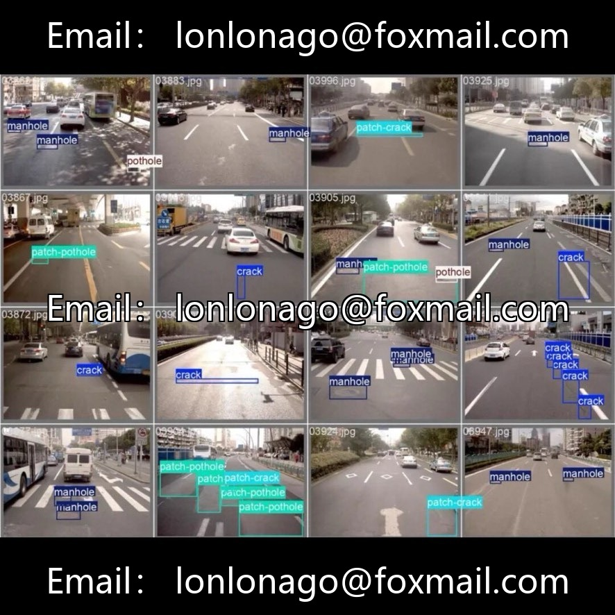
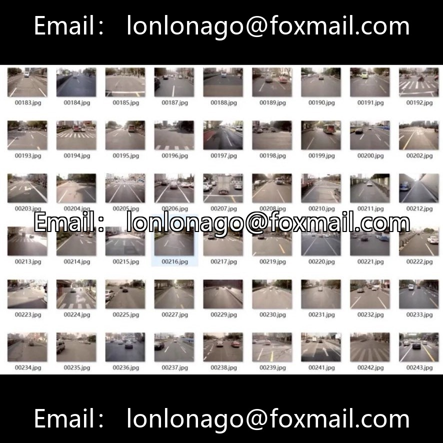
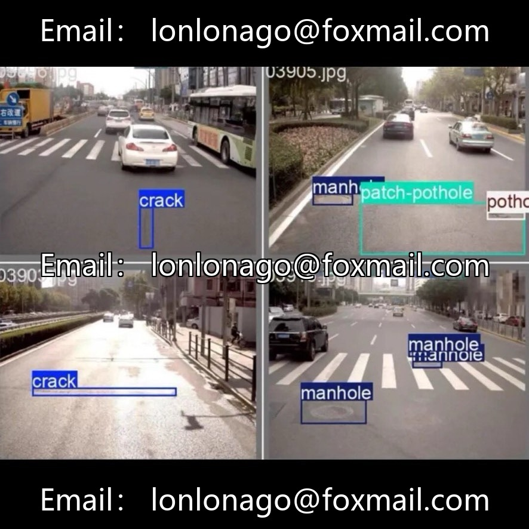

# Road Defects YOLO Annotation Dataset

## Body

Road Defects YOLO Annotation Dataset for Object Detection in Road Defects
This dataset is a resource for road defect target detection with 6000 high-resolution real-world images, in the native YOLO annotation format. It supports conversion to common formats such as VOC and COCO. The dataset includes five categories of targets: crack (cracks), patch-crack (patched cracks), pothole (pits), patch-pothole (patched pits), and manhole (manhole covers). It is suitable for training YOLOv5-v9 models across all series. Sample subsets can be extracted as needed, and it supports multiple annotation format conversions.

The dataset is suitable for smart transportation projects, CV graduation projects, road surface defect algorithms research, small sample/lightweight model experiments, and can also be used in engineering scenarios such as intelligent inspection systems for municipal roads and road maintenance assessment.

Optional Packages: Model Training on Behalf of the Client, Customized Data Augmentation, Model Test Performance Evaluation and Visualization Report

Virtual materials, once sold, are non-refundable.
Interested friends, click "I want" to proceed.

## Images

## Payment

Here is a pay link on Stripe ( https://buy.stripe.com/3cs8yP7sY87d0vu9AB ). Please contact me lonlonago@foxmail.com after funding $89, and I will send you a complete data files , thank you!

